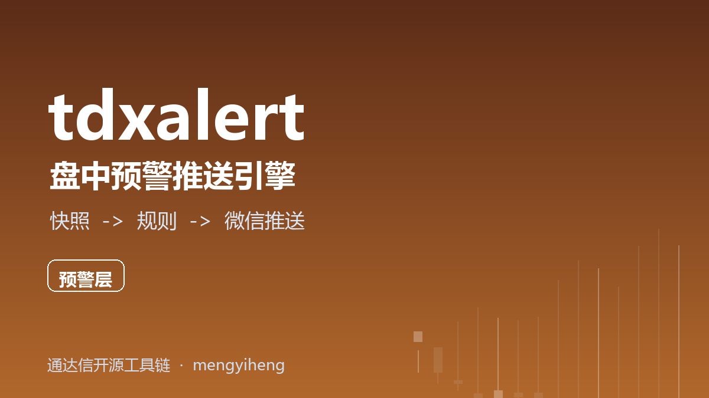

<p align="center"></p>

# tdxalert — 盘中预警推送引擎

把你的**全市场实时快照**接进来，按规则监控，触发即推送**微信**。

- 🔌 **数据源可插拔**：引擎只吃标准化的快照帧——你自己的采集器、pytdx、
  [tdxreplay](https://gitee.com/mengyiheng/tdxreplay) 回放流，都能接
- 📏 **基础规则集**：价格上/下破、涨跌幅超阈、成交量异常放大、参考线上穿/下穿，
  每条规则独立冷却时间
- 💬 **微信推送**：Server酱 / PushPlus，另附钉钉/企微 webhook 与控制台渠道
- 🪶 **零第三方依赖**，纯 Python 标准库
- 🧪 规则引擎与推送解耦，方便先接回放源**离线验证预警逻辑**再上实盘

## 安装

```bash
pip install tdxalert
```

## 快速开始

### 1. 写配置 `alert.json`

```json
{
  "notifiers": { "serverchan": { "key": "SCTxxxxxxxx 你的SendKey" } },
  "rules": [
    { "type": "price_above", "code": "600519", "value": 1500, "cooldown": 600 },
    { "type": "pct_below",   "code": "*",      "value": -3 },
    { "type": "vol_spike",   "code": "*",      "window": 20, "ratio": 3 },
    { "type": "change_dir",  "code": "000001", "value": 10.5 }
  ]
}
```

### 2. 把你的快照流接进来（每行一帧 JSON）

```
{"600519": {"price": 1501.2, "pct": 1.2, "vol": 3200, "name": "贵州茅台"}, "000001": {...}}
```

```bash
your_snapshot_source | tdxalert run --config alert.json
```

### 3. 或者只用 Python API

```python
from tdxalert import AlertEngine

engine = AlertEngine.from_config(cfg)
for frame in my_snapshot_loop():   # 你的 REA / 采集器
    engine.feed(frame)             # 触发即推微信
```

## 规则类型

| type | 含义 | 专属参数 |
|---|---|---|
| `price_above` / `price_below` | 价格上破 / 下破 | `value` 阈值 |
| `pct_above` / `pct_below` | 涨跌幅超阈（%） | `value` |
| `vol_spike` | 成交量较滚动均值放大 | `window` 窗口根数、`ratio` 倍数 |
| `change_dir` | 上穿 / 下穿参考线 | `value` 参考价 |

通用参数：`code`（`"*"`=全市场）、`cooldown` 冷却秒数（默认 300）。

## 快照帧字段约定

| 字段 | 必需 | 说明 |
|---|---|---|
| `price` | ✅ | 最新价 |
| `pct` | 建议 | 涨跌幅 %（正涨负跌） |
| `vol` | 建议 | 成交量（vol_spike 需要） |
| `name` | 可选 | 证券名称（出现在告警文案里） |

## 提示

- **先离线验证再上实盘**：把 [tdxreplay](https://gitee.com/mengyiheng/tdxreplay)
  的回放流转成快照帧喂进来，历史数据上确认规则触发符合预期后再接实时源；
- Server酱 SendKey 获取：<https://sct.ftqq.com/>（微信扫码即用）；
- 规则误报多就加大 `cooldown`；放量告警灵敏度高，`window` 建议不低于 10。

## 免责声明

本项目仅为个人研究工具，不构成任何投资建议；告警可能延迟、丢失或误报。
使用前请[阅读完整免责声明](DISCLAIMER.md)。

## License

MIT
